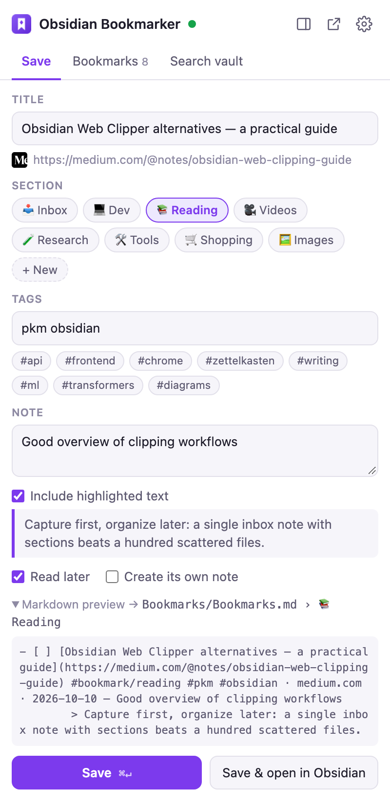
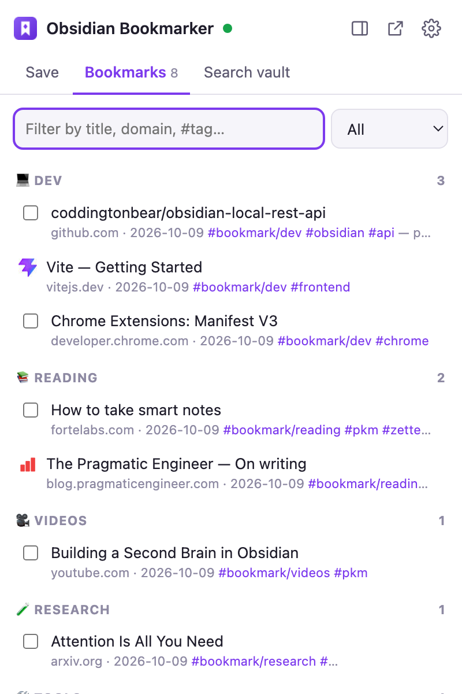
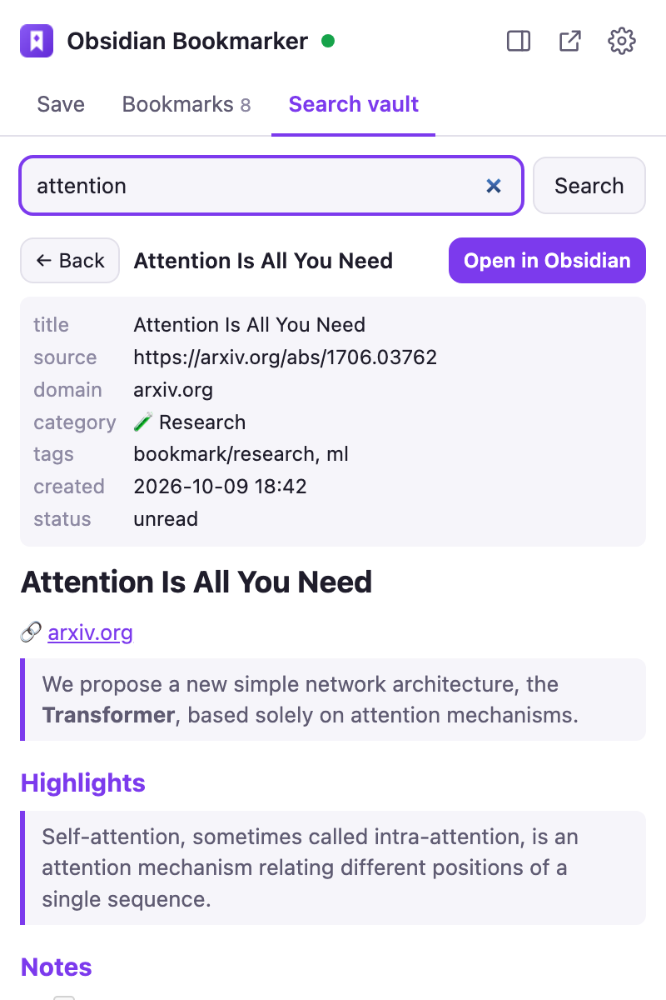
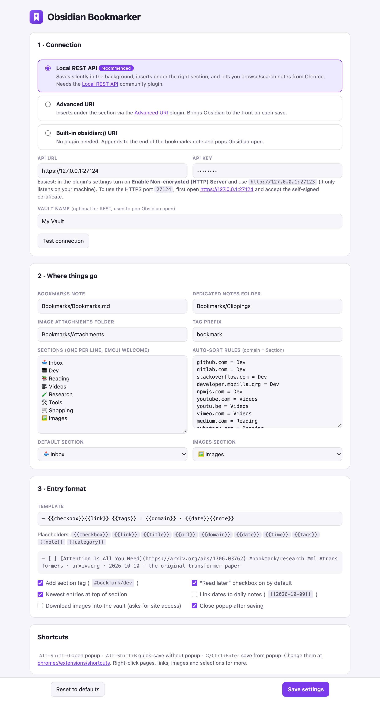
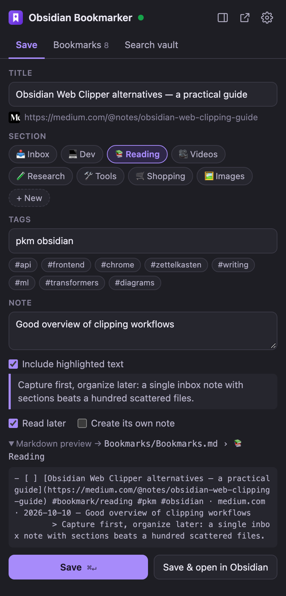
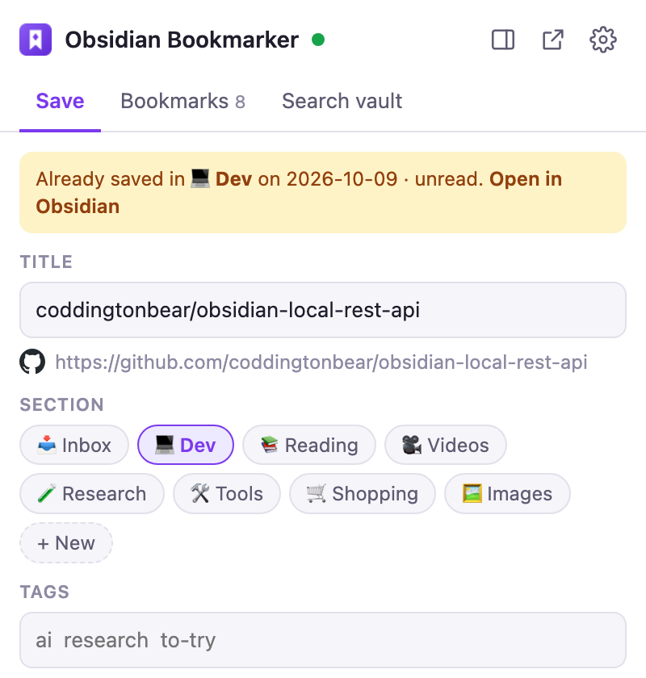
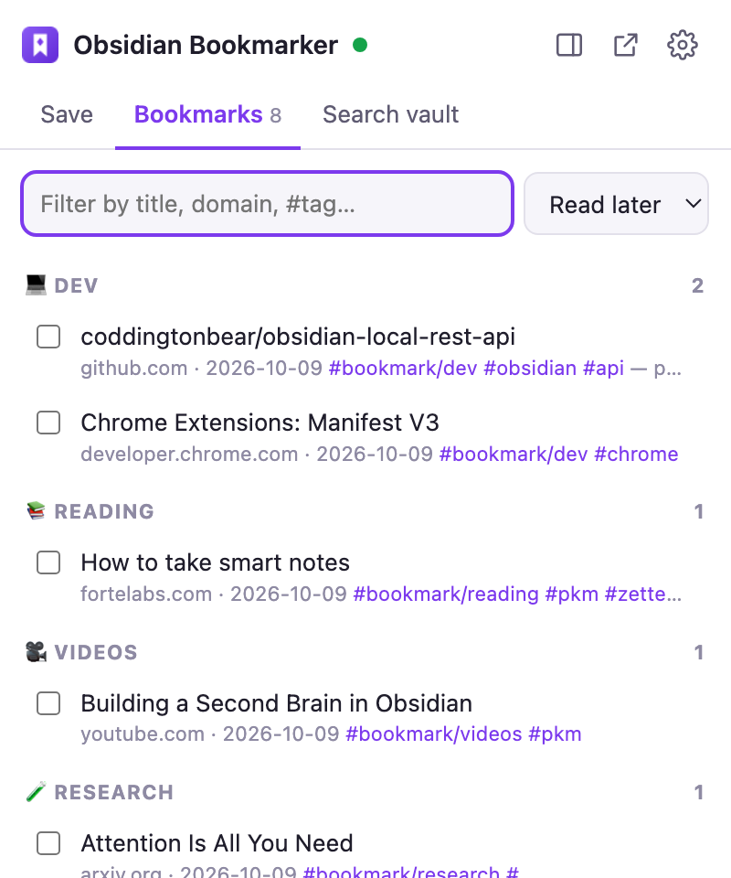
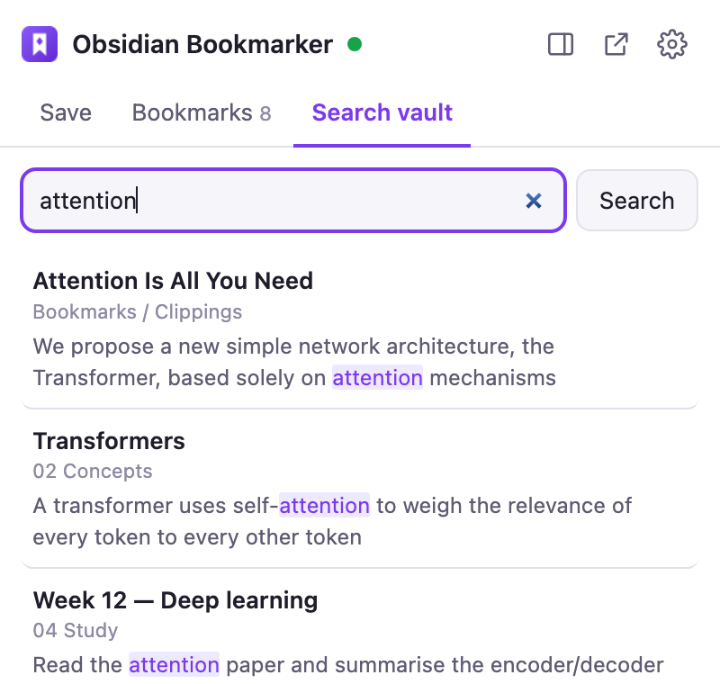
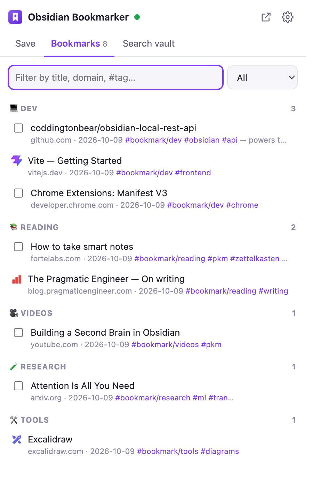
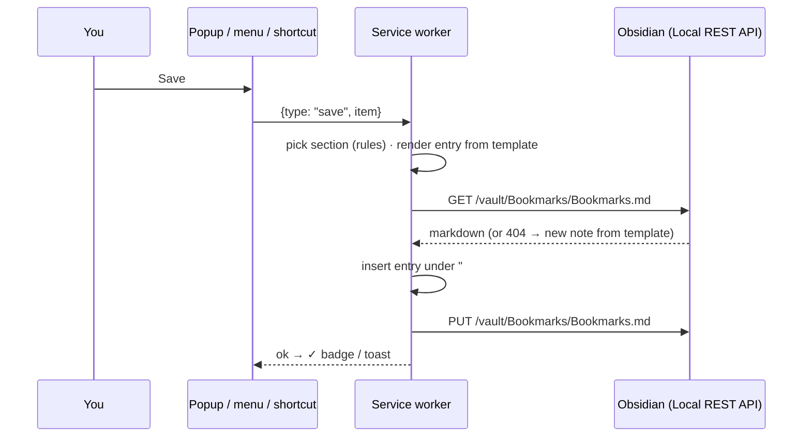

<div align="center">


# Obsidian Bookmarker

**Save pages, links, images and highlights from Chrome straight into an organized Obsidian note — silently, or with a popup — and browse/search your vault without leaving the browser.**

Manifest V3 · No build step · No external servers · Works with the Obsidian **Local REST API** plugin (or plain `obsidian://` links)

</div>

<p align="center">
  
  &nbsp;&nbsp;
  
  &nbsp;&nbsp;
  
</p>

---

## Table of contents

- [Features](#features)
- [How bookmarks are organized in Obsidian](#how-bookmarks-are-organized-in-obsidian)
- [Requirements](#requirements)
- [Setup](#setup)
  - [Step 1 — Install the Local REST API plugin in Obsidian](#step-1--install-the-local-rest-api-plugin-in-obsidian)
  - [Step 2 — Choose HTTP or HTTPS](#step-2--choose-http-or-https)
  - [Step 3 — Load the extension in Chrome](#step-3--load-the-extension-in-chrome)
  - [Step 4 — Configure the extension](#step-4--configure-the-extension)
  - [Alternative: no plugin (obsidian:// URI modes)](#alternative-no-plugin-obsidian-uri-modes)
- [Usage](#usage)
  - [Popup](#popup)
  - [Quick-save shortcut](#quick-save-shortcut)
  - [Right-click menu](#right-click-menu)
  - [Bookmarks tab](#bookmarks-tab)
  - [Search vault tab](#search-vault-tab)
  - [Side panel](#side-panel)
- [Settings reference](#settings-reference)
- [Dataview queries](#dataview-queries)
- [Testing](#testing)
- [Troubleshooting](#troubleshooting)
- [Privacy & permissions](#privacy--permissions)
- [Project structure](#project-structure)
- [Development](#development)

---

## Features

| | |
|---|---|
| 🔖 **One-click save** | Popup with editable title, section picker, tags (with suggestions from your existing tags), a note, and the text you highlighted on the page. |
| ⚡ **Silent quick-save** | `Alt+Shift+B` saves the current page without opening anything. A ✓ badge confirms it. |
| 🖱 **Right-click menu** | Save page · link · image · highlight — or send it straight to a specific section. |
| 🗂 **Auto-sorting** | Domain rules route pages to sections automatically (`github.com → Dev`, `youtube.com → Videos`, …). |
| 📖 **Read-later checklist** | Entries can be `- [ ]` tasks. Tick them off in Obsidian **or** from the extension. |
| 📝 **Dedicated notes** | Optionally create a full note per bookmark with frontmatter, highlights and notes, linked from the hub note. |
| 🖼 **Images** | Embed by URL, or download into your vault's attachments folder. |
| 🔁 **Duplicate detection** | The popup tells you if (and where) a page is already saved. |
| 🔎 **Browse & search** | List all bookmarks by section, filter them, search the whole vault and preview notes — inside Chrome. |
| 🪟 **Side panel** | Keep the same UI docked next to the page; it follows the active tab. |
| 🌗 **Light & dark** | Follows your system theme. |

---

## How bookmarks are organized in Obsidian

Everything lands in **one hub note** (default `Bookmarks/Bookmarks.md`). **Sections are categories**, **tags make it queryable**, and **checkboxes track what you still need to read**:

```markdown
---
tags:
  - bookmarks
---
# 🔖 Bookmarks

## 📥 Inbox

## 💻 Dev
- [ ] [obsidian-local-rest-api](https://github.com/coddingtonbear/obsidian-local-rest-api) #bookmark/dev #obsidian #api · github.com · 2026-10-09 — powers this extension
- [Vite — Getting Started](https://vitejs.dev/guide/) #bookmark/dev #frontend · vitejs.dev · 2026-10-09

## 📚 Reading
- [ ] [How to take smart notes](https://fortelabs.com/blog/how-to-take-smart-notes/) #bookmark/reading #pkm · fortelabs.com · 2026-10-09
	> Capture first, organize later: a single inbox note with sections beats a hundred scattered files.

## 🧪 Research
- [ ] [[Bookmarks/Clippings/Attention Is All You Need|Attention Is All You Need]] [↗](https://arxiv.org/abs/1706.03762) #bookmark/research #ml · arxiv.org · 2026-10-09

## 🖼 Images
- ![[Bookmarks/Attachments/2026-10-09-diagram-12345.png|300]] from [Some article](https://example.com/post) #bookmark/images · 2026-10-09
```

| Concept | How it works |
|---|---|
| **Sections = categories** | Picked automatically by [auto-sort rules](#settings-reference), overridable in the popup. Create new sections on the fly with **+ New**. Matching ignores emoji and case, so `Dev` matches `## 💻 Dev` — rename/decorate headings in Obsidian freely. |
| **Tags** | Every entry gets `#bookmark/<section>` plus your own tags. Obsidian's tag pane nests them; search `tag:#bookmark/dev` anywhere. |
| **Read later** | `- [ ]` = unread, `- [x]` = done. Shows up in Obsidian's task queries. |
| **Highlights** | Selected text is saved as an indented quote under the entry. |
| **Dedicated notes** | `Bookmarks/Clippings/<Title>.md` with `source`, `domain`, `category`, `tags`, `created`, `description`, `image`, `status` frontmatter + *Highlights* and *Notes* sections. The hub entry links it with a `[[wikilink]]`, so it appears in the graph and backlinks. |
| **Order** | Newest first within each section (configurable). |

<details>
<summary>Example dedicated note</summary>

```markdown
---
title: "Attention Is All You Need"
source: "https://arxiv.org/abs/1706.03762"
domain: "arxiv.org"
category: "🧪 Research"
tags:
  - bookmark/research
  - ml
created: 2026-10-09 18:42
description: "We propose a new simple network architecture, the Transformer…"
status: unread
---
# Attention Is All You Need

🔗 [arxiv.org](https://arxiv.org/abs/1706.03762)

> We propose a new simple network architecture, the Transformer…

## Highlights

> Self-attention, sometimes called intra-attention, is an attention mechanism…

## Notes

the original transformer paper
```
</details>

---

## Requirements

- **Google Chrome** (or any Chromium browser: Edge, Brave, Arc) version 116+
- **Obsidian** desktop app (macOS / Windows / Linux)
- **[Local REST API](https://github.com/coddingtonbear/obsidian-local-rest-api)** community plugin — recommended. Tested with plugin **v5.4.0** on Obsidian **1.14.4**.
  *(Optional alternative: no plugin at all, or the [Advanced URI](https://github.com/Vinzent03/obsidian-advanced-uri) plugin — see [below](#alternative-no-plugin-obsidian-uri-modes).)*

---

## Setup

### Step 1 — Install the Local REST API plugin in Obsidian

1. Open Obsidian → **Settings** (⚙ bottom-left) → **Community plugins**.
2. If prompted, click **Turn on community plugins**.
3. Click **Browse**, search for **Local REST API**, click **Install**, then **Enable**.
4. Go to **Settings → Local REST API** (under *Community plugins* in the sidebar) and **copy the API Key**.

Check it's running (replace `YOUR_KEY`):

```bash
curl -k -H "Authorization: Bearer YOUR_KEY" https://127.0.0.1:27124/
```

You should see JSON containing `"authenticated": true`.

> `-k` skips certificate verification because the plugin uses a self-signed certificate. Without it curl reports `SSL certificate problem: self signed certificate` — that's expected and means the server **is** running.

### Step 2 — Choose HTTP or HTTPS

Chrome rejects self-signed certificates just like curl does, so pick one:

**Option A — HTTP (easiest, recommended)**

1. In **Settings → Local REST API**, turn on **Enable Non-encrypted (HTTP) Server**.
2. Use API URL `http://127.0.0.1:27123` in the extension (the default).

The HTTP server only listens on `127.0.0.1`, so it's not reachable from other machines.

```bash
curl -H "Authorization: Bearer YOUR_KEY" http://127.0.0.1:27123/
```

**Option B — HTTPS (keep encryption)**

1. In Chrome, open `https://127.0.0.1:27124/obsidian-local-rest-api.crt` to download the plugin's certificate.
2. **macOS:** double-click the file → it opens in **Keychain Access** → double-click the certificate → expand **Trust** → set **When using this certificate** to **Always Trust** → close and enter your password.
   **Windows:** double-click → **Install Certificate** → *Current User* → *Place all certificates in* → **Trusted Root Certification Authorities**.
3. Restart Chrome and use API URL `https://127.0.0.1:27124` in the extension.

> Quick-but-temporary alternative: visit `https://127.0.0.1:27124`, click **Advanced → Proceed**. Chrome forgets this after a while, so saves will eventually start failing again.

### Step 3 — Load the extension in Chrome

```bash
git clone https://github.com/giridharmb/chrome-obsidian.git
```

1. Open `chrome://extensions`.
2. Turn on **Developer mode** (top-right toggle).
3. Click **Load unpacked** and select the cloned `chrome-obsidian` folder (the one containing `manifest.json`).
4. Pin it: click the 🧩 puzzle icon in the toolbar → 📌 next to **Obsidian Bookmarker**.

The settings page opens automatically on first install.

### Step 4 — Configure the extension



1. **Connection** — select **Local REST API**, set the **API URL** from Step 2, paste the **API key**, and (optionally) your **vault name** — it's used to bring Obsidian to the front when you click *Open in Obsidian*.
2. Click **Test connection** — you should see **Connected · Obsidian Local REST API x.y.z** in green.
3. **Where things go** — adjust the bookmarks note path, folders, sections and auto-sort rules if you like (e.g. `05 Resources/Bookmarks.md`).
4. Click **Save settings**.

That's it — open any web page and press `Alt+Shift+O`.

### Alternative: no plugin (obsidian:// URI modes)

| Mode | Plugin needed | Inserts under section | Obsidian pops up on save | Browse / search in Chrome |
|---|---|:---:|:---:|:---:|
| **Local REST API** | Local REST API | ✅ | ❌ (silent) | ✅ |
| **Advanced URI** | Advanced URI | ✅ | ✅ | ❌ |
| **Built-in obsidian:// URI** | none | ❌ (appends to end) | ✅ | ❌ *(search box opens Obsidian's search)* |

For URI modes, set the **vault name** exactly as it appears in Obsidian's vault switcher. The first time, Chrome asks *"Open Obsidian?"* — tick **Always allow** to skip it next time.

---

## Usage

### Popup

Press `Alt+Shift+O` or click the toolbar icon.

<p>
  
  &nbsp;&nbsp;
  
</p>

- **Title** — prefilled from the page (`og:title` / `<title>`), editable.
- **Section** — auto-selected from your rules; click another chip or **+ New** to create one.
- **Tags** — space- or comma-separated; click suggestions (your most-used tags) to add them.
- **Note** — a one-liner appended after `—`.
- **Include highlighted text** — appears when you had text selected on the page.
- **Read later** — adds the `- [ ]` checkbox.
- **Create its own note** — also writes a dedicated note in the clippings folder.
- **Markdown preview** — shows exactly what will be written and where.
- **Save** (`⌘/Ctrl + Enter`) or **Save & open in Obsidian** (`⌘/Ctrl + Shift + Enter`).

If the page is already saved, you'll see where:



Header buttons: **▯** open side panel · **↗** open the bookmarks note in Obsidian · **⚙** settings. The dot next to the title is the connection status (green = connected; hover for details).

### Quick-save shortcut

`Alt+Shift+B` saves the current page using the auto-sort section and default read-later setting. If you have text selected, it's included as a highlight. The toolbar icon flashes **✓** (green) on success or **!** (red) with a notification on failure.

### Right-click menu

| Right-click on | Menu item | Result |
|---|---|---|
| Page | **Save page to Obsidian** | Saves with auto-sorted section |
| Page | **Save page to Obsidian section… ▸** | Pick the section |
| Link | **Save link to Obsidian** / **…section ▸** | Uses the link's text as the title |
| Selected text | **Save highlight to Obsidian** | Page link + the quote |
| Image | **Save image to Obsidian** | Goes to the *Images* section (embedded, or downloaded if enabled) |
| Toolbar icon | **Open bookmarks note in Obsidian** / **Open Obsidian side panel** | |

### Bookmarks tab

<p>
  
  &nbsp;&nbsp;
  
</p>

- Grouped by section (click a section header to collapse it).
- Filter by title, domain, note or `#tag`; switch between **All / Read later / Done**.
- Tick the checkbox to mark as read — it updates `- [ ]` → `- [x]` in Obsidian.
- Click a title to open the page. Entries with a dedicated note show **Note** (open in Obsidian) and **View** (preview here) on hover.

### Search vault tab

<p>
  
  &nbsp;&nbsp;
  
</p>

Searches **all notes in your vault** (not just bookmarks) via the REST API. Click a result to preview it — frontmatter, headings, lists, callouts, `[[wikilinks]]` (clickable) and tags are rendered. **Open in Obsidian** jumps to the note in the app.

### Side panel



Click **▯** in the popup header (or right-click the toolbar icon → *Open Obsidian side panel*). The panel stays open while you browse and updates to whichever tab is active.

### Keyboard shortcuts

| Shortcut | Action |
|---|---|
| `Alt+Shift+O` | Open the popup |
| `Alt+Shift+B` | Quick-save current page (no popup) |
| `⌘/Ctrl+Enter` | Save (in popup) |
| `⌘/Ctrl+Shift+Enter` | Save & open in Obsidian (in popup) |

Change them at `chrome://extensions/shortcuts`.

---

## Settings reference

| Setting | Default | Description |
|---|---|---|
| Mode | Local REST API | `Local REST API`, `Advanced URI`, or `Built-in obsidian:// URI` |
| API URL | `http://127.0.0.1:27123` | Use `https://127.0.0.1:27124` for HTTPS |
| API key | — | From Obsidian → Settings → Local REST API. Stored only in `chrome.storage.local` on this machine. |
| Vault name | — | Needed for URI modes; optional for REST (used to focus Obsidian) |
| Bookmarks note | `Bookmarks/Bookmarks.md` | Created automatically with all sections on first save |
| Dedicated notes folder | `Bookmarks/Clippings` | For "Create its own note" |
| Image attachments folder | `Bookmarks/Attachments` | For downloaded images |
| Tag prefix | `bookmark` | Section tag becomes `#bookmark/<section>`; leave empty for `#<section>` |
| Sections | Inbox, Dev, Reading, Videos, Research, Tools, Shopping, Images | One per line, emoji welcome. Order = order in a new note. |
| Auto-sort rules | `github.com = Dev`, `youtube.com = Videos`, … | `pattern = Section`. Pattern matches part of the hostname; if it contains `/` it's matched against the full URL. First match wins. |
| Default section | 📥 Inbox | When no rule matches |
| Images section | 🖼 Images | Where images go |
| Template | `- {{checkbox}}{{link}} {{tags}} · {{domain}} · {{date}}{{note}}` | Placeholders: `{{checkbox}} {{link}} {{title}} {{url}} {{domain}} {{date}} {{time}} {{tags}} {{note}} {{category}}` |
| Add section tag | on | Adds `#bookmark/<section>` |
| Read later on by default | on | Pre-ticks *Read later* in the popup and for quick-saves |
| Newest first | on | Insert at the top of the section instead of the bottom |
| Link dates to daily notes | off | Writes `[[2026-10-09]]` instead of `2026-10-09` |
| Download images into the vault | off | Asks Chrome for site access when enabled; falls back to remote URL if a download fails |
| Close popup after saving | on | |

---

## Dataview queries

Optional — with the [Dataview](https://github.com/blacksmithgu/obsidian-dataview) plugin you can build dashboards anywhere in your vault:

````markdown
### 📖 Reading list
```dataview
TASK FROM "Bookmarks/Bookmarks"
WHERE !completed
GROUP BY meta(section).subpath
```

### 📝 Clipped notes
```dataview
TABLE source, category, status, created
FROM "Bookmarks/Clippings"
SORT created DESC
```

### 🏷 Everything tagged #ml
```dataview
TASK FROM #ml
```
````

Without Dataview, Obsidian's built-in search works too: `tag:#bookmark/dev`, `task-todo:""` inside `path:Bookmarks`, etc.

---

## Testing

### Automated

Unit tests cover the markdown logic (formatting, section insertion, parsing, toggling, rendering):

```bash
npm test
```

### Manual checklist

| # | Test | Expected |
|---|---|---|
| 1 | Settings → **Test connection** | Green "Connected · …" |
| 2 | Popup on a GitHub page → **Save** | Entry under `## 💻 Dev` in `Bookmarks/Bookmarks.md` |
| 3 | Open the popup on the same page again | Yellow "Already saved in 💻 Dev…" |
| 4 | `Alt+Shift+B` on a YouTube video | ✓ badge, entry under 🎥 Videos |
| 5 | Select text → right-click → **Save highlight** | Entry with an indented `> quote` |
| 6 | Right-click a link → **…section ▸ Reading** | Uses link text as title, under 📚 Reading |
| 7 | Right-click an image → **Save image** | Embedded under 🖼 Images |
| 8 | Popup → tick **Create its own note** → Save | New note in `Bookmarks/Clippings/`, linked from the hub |
| 9 | **Bookmarks** tab → tick a checkbox | `- [ ]` becomes `- [x]` in Obsidian |
| 10 | **Search vault** → search a word → click result | Note preview + *Open in Obsidian* works |
| 11 | ▯ → side panel → switch tabs | Panel updates to the active page |
| 12 | Quit Obsidian → `Alt+Shift+B` | Red **!** badge + "Can't reach Obsidian" notification |

### Screenshots

The screenshots in this README are generated from the real popup/options pages with a mocked `chrome.*` API and sample data:

```bash
npm run screenshots                       # all scenes → docs/images/
ONLY=popup-save,options npm run screenshots
```

---

## Troubleshooting

| Problem | Fix |
|---|---|
| **"Can't reach Obsidian at …"** | Obsidian must be open with the Local REST API plugin enabled. Check the URL/port. For HTTPS, the certificate must be trusted ([Step 2](#step-2--choose-http-or-https)). |
| `curl: (60) SSL certificate problem: self signed certificate` | Expected with HTTPS. Use `curl -k`, or switch to the HTTP server. |
| **"Obsidian rejected the API key"** | Re-copy the key from the plugin settings (it changes if you click *Reset API key*). |
| Nothing happens on a page | Chrome blocks extensions on `chrome://` pages and the Chrome Web Store. Try a normal website. |
| Shortcut doesn't work | Another app/extension may own it. Reassign at `chrome://extensions/shortcuts`. |
| URI mode opens the wrong vault | Set **Vault name** exactly as shown in Obsidian's vault switcher. |
| Image saved as a remote link instead of a file | Enable *Download images* and grant site access; some sites block hotlinking — the extension then falls back to the remote URL. |
| Entries go to a new section instead of an existing one | The section name in settings must match the heading text (emoji/case don't matter, words do). |

**Debugging:** `chrome://extensions` → Obsidian Bookmarker → **service worker** opens the background console (context menu, shortcut, saving). Right-click inside the popup → **Inspect** for the popup console. After editing code, click ↻ on the extension card.

---

## Privacy & permissions

The extension talks **only to Obsidian on your own machine** (`127.0.0.1` / `localhost`). No analytics, no external servers. Your API key and settings are stored in `chrome.storage.local` and never synced.

| Permission | Why |
|---|---|
| `activeTab`, `scripting` | Read the current page's title, description, preview image and your text selection when you save |
| `tabs` | Read the active tab's title/URL (needed for the side panel, which doesn't get `activeTab`) |
| `contextMenus` | Right-click menu items |
| `storage` | Save your settings locally |
| `notifications` | Show an error if a background save fails |
| `sidePanel` | The docked side panel |
| `favicon` | Show site icons in the bookmarks list (served by Chrome locally) |
| `http(s)://127.0.0.1/*`, `http(s)://localhost/*` | Reach the Local REST API |
| `<all_urls>` *(optional, off by default)* | Only requested if you enable *Download images into the vault* |

---

## Project structure

```
chrome-obsidian/
├── manifest.json              MV3 manifest (permissions, shortcuts, side panel)
├── src/
│   ├── background.js          Service worker: context menus, shortcuts, message router
│   └── lib/
│       ├── core.js            Save / browse / search orchestration, serialized writes
│       ├── markdown.js        Entry formatting, section insertion, parsing, safe MD renderer
│       ├── obsidian.js        Local REST API client + obsidian:// URI builders
│       ├── page.js            Page metadata extraction (title, og:*, selection)
│       └── settings.js        Defaults + chrome.storage helpers
├── popup/                     Popup UI (also used as the side panel)
├── options/                   Settings page
├── icons/                     Extension icons
├── tests/markdown.test.js     Node unit tests
├── scripts/screenshots/       Headless-Chrome screenshot harness (mocked chrome.* APIs)
└── docs/images/               README screenshots
```

### How a save works



Writes are serialized in the service worker, so rapid saves never overwrite each other.

---

## Development

No build step — plain ES modules.

```bash
npm test              # unit tests (Node 18+)
npm run screenshots   # regenerate README screenshots (needs Google Chrome)
npm run zip           # package for the Chrome Web Store → obsidian-bookmarker.zip
```

Edit files, then click ↻ on the extension card in `chrome://extensions` and reopen the popup.
